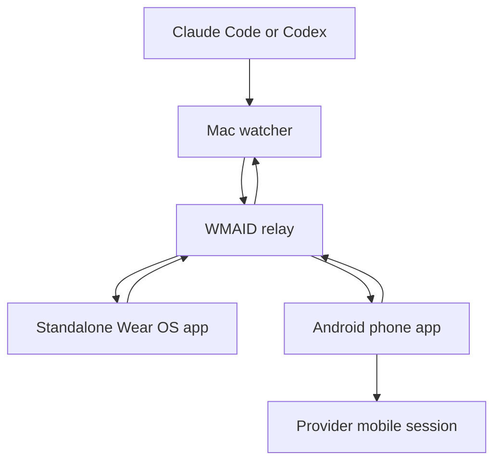
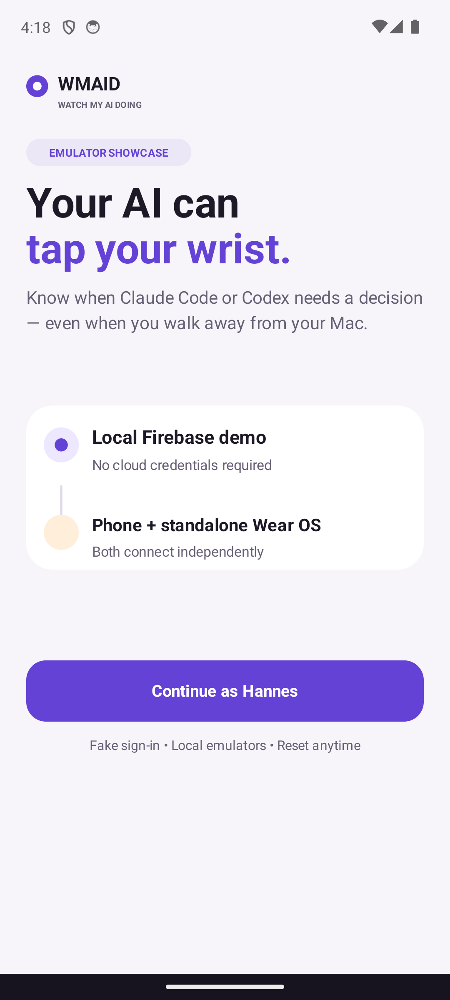
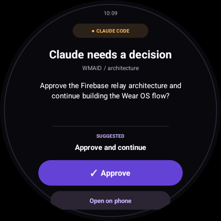
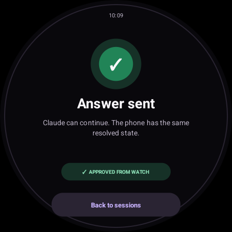
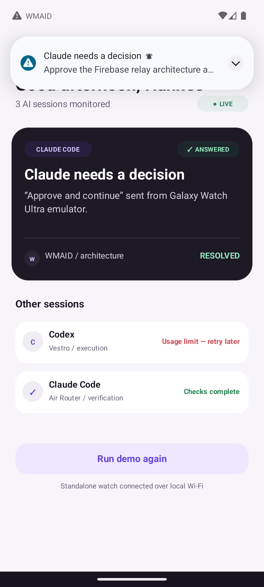
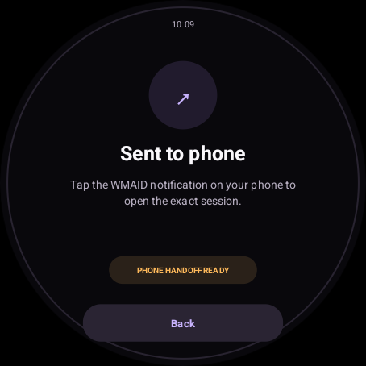
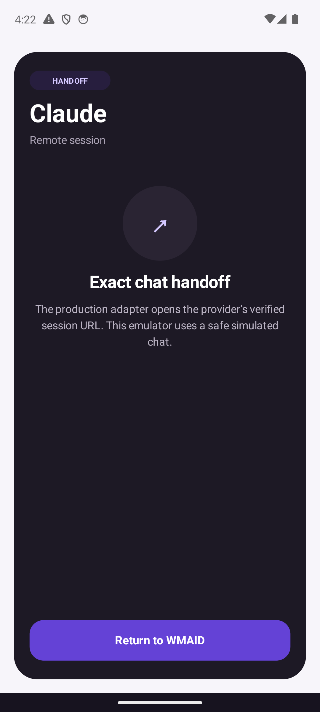

# WMAID — Watch My AI Doing

Your AI taps your wrist when it needs you.

WMAID is an emulator-first Android and Wear OS showcase for supervising Claude Code and Codex sessions away from the Mac. It turns waiting prompts, permission requests, overloads, and failures into concise phone and watch notifications that can be answered or handed off to the corresponding mobile session.

## Project status

The product contract and Firebase project are established. The first milestone uses a fake Mac agent, Firebase Auth and Firestore emulators, an Android phone emulator, and a standalone Wear OS emulator.

- Firebase project: `watch-my-ai-doing`
- Android package: `com.oxiomsystems.wmaid`
- Cloud deployment: not enabled
- Google Play release: held until a developer account is available
- Live Claude and Codex adapters: deferred until the emulator showcase passes

## Product shape



The watch is a first-class network client. It does not require a live phone connection for its core notification and reply flow.

## Emulator-first definition

The first runnable demonstration must prove:

1. Fake pairing on both phone and watch.
2. A simulated Claude or Codex interruption reaches both clients.
3. A reply from the watch resolves the same event on the phone.
4. A long question hands off to a simulated provider-session screen.
5. Repeatable commands capture phone and round-watch screenshots.

See the [requirements-only plan](plans/2026-07-30-001-feat-wmaid-emulator-first-agent-notifications-plan.md) and [architecture](docs/architecture.md).

## Run the showcase

Prerequisites are Android SDK 36, a phone AVD named `Pixel_6_API_34`, a round
Wear OS AVD named `WMAID_Wear_OS_6`, JDK 17, Node.js, and the Firebase CLI.

```bash
npx firebase-tools emulators:start --project demo-watch-my-ai-doing
./scripts/start-emulators.sh
./scripts/install-demo.sh
```

The two apps sign in independently to the Authentication emulator and observe
the same Firestore alert collection. Tap **Connect demo** on both devices, then
tap **Approve** on the watch. The watch changes to **Answer sent**, and the
phone's waiting session resolves from the same Firestore update.

Capture repeatable evidence with:

```bash
./scripts/capture-evidence.sh
```

The debug profile contains only test Firebase identifiers. It does not require
`google-services.json` or any production secret.

## Verified emulator flow

The July 30, 2026 emulator run verified anonymous sign-in to the local
Authentication emulator, live shared state through Firestore, a watch reply
resolving the phone event, and a watch-requested phone handoff.

| Phone onboarding | Watch prompt | Watch answer |
| --- | --- | --- |
|  |  |  |

| Phone sees watch reply | Watch requests handoff | Phone opens session |
| --- | --- | --- |
|  |  |  |

## Updates without a debugger

The **Manual Android build** GitHub Actions workflow produces consistently
signed phone and watch APKs. It does not run on pushes. Publishing a public
GitHub prerelease requires an explicit workflow input; otherwise the APKs stay
inside the workflow artifact.

See [release lanes](docs/releasing.md) for secret names and the held Google Play
internal-testing path.

## Security

The repository must never contain:

- signing keys or passwords
- Firebase service-account credentials
- personal Claude or Codex transcripts
- production access tokens
- real prompt content captured without an explicit project policy

Firebase client configuration and release credentials are materialized from local configuration or private GitHub Actions secrets.

## License

Apache-2.0
