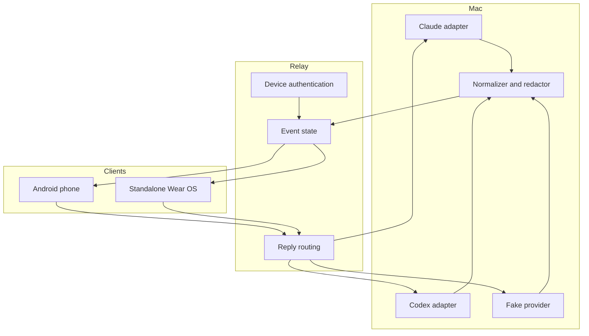

# WMAID architecture

## Runtime boundaries

WMAID separates provider detection, event transport, device presentation, and reply routing so the emulator showcase can use fakes without changing the production boundaries.

## Emulator profile

The emulator profile uses Firebase Authentication and Firestore emulators. Both clients connect to the host through the Android emulator host alias and share event state through Firestore. A fake provider supplies deterministic Claude, Codex, permission, overload, error, short-question, and long-question scenarios.

Firebase Cloud Messaging is not required for this profile. The clients observe Firestore state while active, allowing deterministic end-to-end testing without production credentials.

## Production profile

The planned production profile replaces the local emulator endpoints with Firebase Authentication, Firestore, and direct Firebase Cloud Messaging delivery to each device. The Wear OS app receives its own device token and remains independent of the phone.

The Mac watcher makes outbound authenticated requests only. No inbound public Mac port is required.

## Handoff policy

Claude Remote Control session URLs are the preferred exact-session handoff when available. Codex uses a provider adapter and WMAID fallback until an exact mobile session-link contract is verified.

## Secret boundary

Public configuration contains project identifiers, package identifiers, emulator ports, and schemas. Private configuration contains signing material, service accounts, release credentials, and any token that grants data or deployment access.
