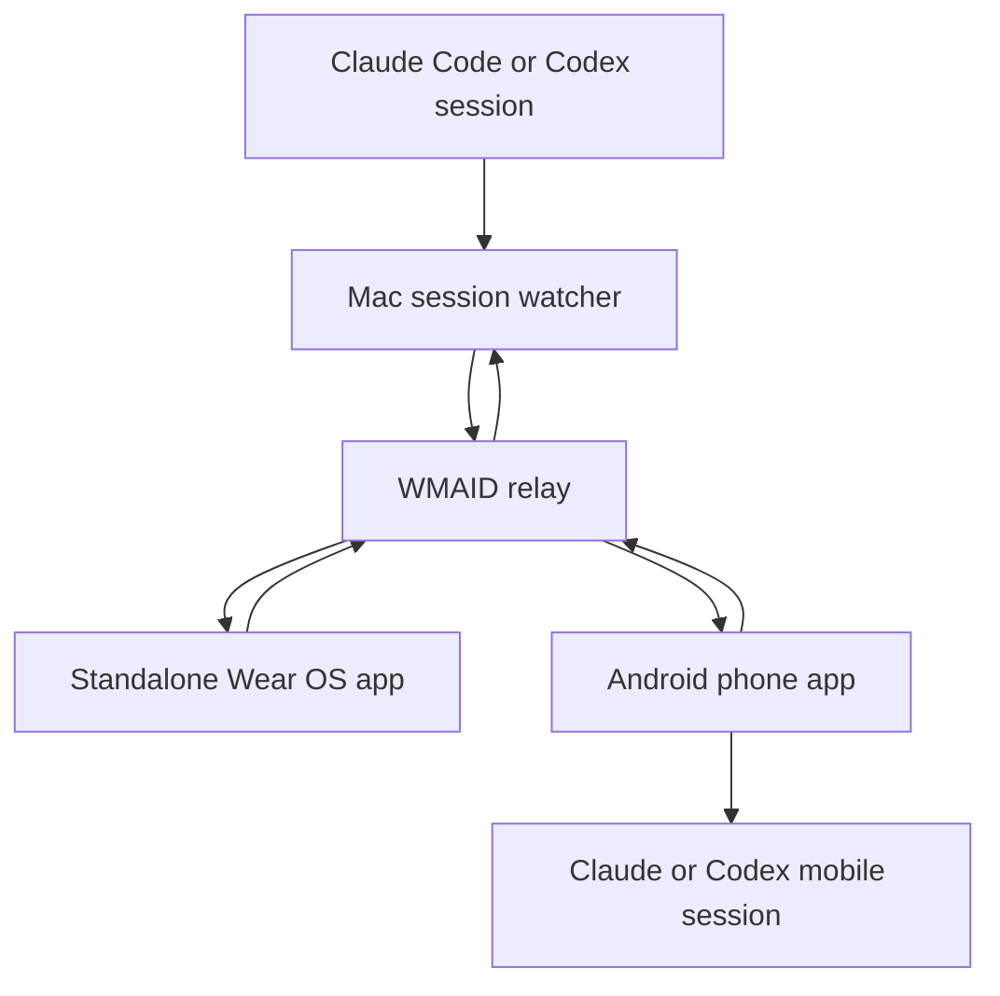

# WMAID - Watch My AI Doing - Plan

## Goal Capsule

- **Objective:** Create a public, emulator-first showcase that alerts an Android phone and standalone Wear OS watch when local Claude Code or Codex sessions need attention, and lets the user reply or open the relevant mobile session.
- **Product authority:** The confirmed stakeholder scope in the 2026-07-30 WMAID design dialogue.
- **Open blockers:** Google Play deployment requires a developer account. Exact-session Codex mobile handoff remains unverified.

---

## Product Contract

### Summary

WMAID monitors local AI coding sessions and sends concise, actionable alerts to an Android phone and a standalone Galaxy Watch Ultra app.
The first demonstrable release uses emulators and replaceable fake integrations so the complete experience can be tested, photographed, and shown before physical-device or production-service work.

### Problem Frame

Multiple Claude Code and Codex sessions can stop for permission, clarification, overload, or an error while the operator is away from the Mac.
The operator currently has to revisit each session to discover that work has paused, which wastes time and makes parallel agent work difficult to supervise.
The showcase succeeds when the interruption reaches the operator's wrist, explains what needs attention, and provides the shortest safe path back into the session.

### Key Decisions

- **Emulator-first delivery** (session-settled: user-directed — chosen over physical-device-first: the showcase must produce repeatable visual and behavioral evidence before hardware integration). Governs R14-R17.
- **Standalone watch experience** (session-settled: user-directed — chosen over phone-dependent mirroring: the Galaxy Watch Ultra must remain useful over Wi-Fi or LTE without its phone). Governs R7-R9.
- **Replaceable fake integrations** (session-settled: user-approved — chosen over blocking on live provider integration: a convincing end-to-end demonstration is more valuable than incomplete production wiring). Governs R14-R16.
- **Manual release deployment** (session-settled: user-directed — chosen over deploy-on-push: deployment should happen only when a release is intentionally requested). Governs R21-R23.
- **Firebase-backed first architecture:** Firebase is the initial authentication, event-state, and messaging backbone, with local fakes available for deterministic emulator testing. Governs R11-R13 and R18.

### Actors

- A1. **Operator:** Supervises multiple local AI coding sessions and responds from the watch or phone.
- A2. **Mac session watcher:** Converts provider-specific session events into a common WMAID event.
- A3. **WMAID relay:** Authenticates devices, synchronizes event state, and routes replies.
- A4. **Wear OS app:** Receives events independently and supports glanceable review and short replies.
- A5. **Android phone app:** Shows richer event detail and hands the operator into the relevant provider session.
- A6. **Provider adapter:** Detects, reads, and responds to one Claude Code or Codex session without exposing provider-specific behavior to the clients.

### Requirements

**Session attention**

- R1. WMAID must notify the operator when a monitored Claude Code or Codex session is waiting for input, requesting permission, stopped by overload, or stopped by an error.
- R2. Every event must identify the provider, session, project, attention reason, creation time, and current resolution state.
- R3. WMAID must produce a watch-sized redacted summary without losing the action the operator needs to take.
- R4. A short event may include suggested answers while keeping the original question available in the detailed view.
- R5. The operator must be able to dismiss, defer, or reply to an event from the watch or phone.
- R6. A reply that can resume or materially affect a coding session must require an explicit operator confirmation before transmission.

**Standalone device experience**

- R7. The Wear OS app must receive and act on WMAID events without a live connection to the phone.
- R8. The phone and watch must synchronize event and reply state through the relay rather than depending on a direct device-to-device connection.
- R9. Delivery to both clients must avoid presenting duplicate watch notifications for one event.
- R10. Tapping a phone or watch handoff must open the corresponding provider session when a verified provider link exists.
- R11. When exact-session handoff is unavailable, WMAID must open a provider-specific fallback that preserves enough session identity for the operator to continue.

**Relay, authentication, and privacy**

- R12. The relay must authenticate each Mac, phone, and watch installation before accepting event or reply traffic.
- R13. The relay must expose only the minimum event content required by the selected notification-detail policy.
- R14. WMAID must redact likely credentials, tokens, and sensitive values before any question or summary leaves the Mac.
- R15. WMAID must never silently approve commands, permissions, or destructive actions.

**Emulator-first validation**

- R16. The first runnable milestone must support an Android phone emulator and a Wear OS round-display emulator.
- R17. The emulator experience must include fake login, fake Claude and Codex sessions, simulated attention events, suggested answers, replies, and handoff destinations.
- R18. The phone and watch emulators must demonstrate that they receive the same event and converge on the same resolution state through the relay.
- R19. The project must provide repeatable commands that launch the demo, seed representative events, and capture screenshots from both emulators.
- R20. Automated verification must cover event delivery, state synchronization, redaction, and reply routing where the behavior can be tested below the UI.

**Public project and distribution**

- R21. The public repository must contain the Mac watcher, relay, Android phone app, standalone Wear OS app, architecture, demo mode, tests, and setup documentation.
- R22. The public repository must not contain signing keys, service-account credentials, access tokens, personal session transcripts, or production environment values.
- R23. Continuous integration must build and test development artifacts without publishing them.
- R24. A release workflow must publish only after an intentional manual trigger and must obtain sensitive values from private repository secrets.
- R25. The planned update channel must support independent phone and Wear OS updates without requiring a debugging connection.
- R26. Google Play internal testing must remain the preferred update channel once a developer account is available.

### Key Flows

- F1. Simulated attention event
  - **Trigger:** A fake Claude or Codex session enters a waiting, permission, overload, or error state.
  - **Actors:** A2, A3, A4, A5
  - **Steps:** The watcher emits a normalized event, the relay stores it, and both clients display the matching event.
  - **Outcome:** Phone and watch show one synchronized actionable interruption.
  - **Covers:** R1-R4, R7-R9, R16-R18

- F2. Short watch reply
  - **Trigger:** The operator opens a short event on the watch.
  - **Actors:** A1, A3, A4, A6
  - **Steps:** The operator chooses or dictates a reply, confirms it, and the relay routes it to the matching provider adapter.
  - **Outcome:** The simulated session resumes and both clients show the event as resolved.
  - **Covers:** R5-R6, R8, R12, R18

- F3. Phone handoff
  - **Trigger:** The event is too complex to answer from the watch.
  - **Actors:** A1, A4, A5
  - **Steps:** The operator chooses the phone action, WMAID opens the provider destination, and the session context remains identifiable.
  - **Outcome:** The operator continues in the provider's mobile experience or a WMAID fallback.
  - **Covers:** R10-R11

- F4. Intentional test release
  - **Trigger:** A maintainer manually requests a release.
  - **Actors:** A1
  - **Steps:** The workflow verifies, signs, and publishes eligible phone and watch artifacts using private repository secrets.
  - **Outcome:** Installed clients can receive an update without a debugging connection.
  - **Covers:** R22-R26

### Acceptance Examples

- AE1. **Covers R16-R17.** Given clean phone and watch emulators, when the documented demo command runs, then both apps install, launch, and complete the fake pairing flow.
- AE2. **Covers R1-R4, R18.** Given paired emulators, when a simulated Claude permission event is seeded, then both clients show the same provider, project, summary, and unresolved state.
- AE3. **Covers R5-R6, R18.** Given a short simulated question on the watch, when the operator confirms a suggested answer, then the fake session receives it and both clients show the event as resolved.
- AE4. **Covers R10-R11.** Given a long simulated Codex question, when the operator chooses the phone handoff, then the phone opens the matching simulated provider-session screen.
- AE5. **Covers R14-R15.** Given a simulated prompt containing a token-like value and a destructive permission request, when WMAID creates the event, then the value is redacted and no approval is transmitted without confirmation.
- AE6. **Covers R7-R8.** Given the phone emulator is stopped, when the relay sends a new event, then the watch emulator receives and resolves it independently.
- AE7. **Covers R19-R20.** Given the demo flow passes, when the evidence command runs, then it writes phone and watch screenshots plus machine-readable test results.

### Success Criteria

- A clean checkout can run the fake end-to-end demo without Claude, Codex, Google Play, or physical hardware accounts.
- The evidence set contains readable phone and round-watch screenshots for login, attention, reply, resolution, error, and handoff states.
- Tests prove that one event and one reply retain the same identity across watcher, relay, phone, and watch boundaries.
- The public repository exposes no sensitive credential or personal session content.

### Scope Boundaries

**Deferred for later**

- Physical Galaxy Watch Ultra and Android phone validation.
- Live Claude Code and Codex provider adapters.
- Production Firebase deployment and external push delivery.
- Exact-session Codex mobile handoff.
- Google Play internal-test publication and unattended update verification.

**Outside this product's identity**

- A multi-user agent-monitoring SaaS.
- A general remote desktop or terminal client.
- Silent automation of coding-agent permission decisions.
- Replacement of Claude or Codex mobile clients.

### Dependencies and Assumptions

- Firebase project access is available through the stakeholder's signed-in Chrome session.
- The first milestone may use Firebase emulators or in-process fakes when cloud setup would reduce determinism.
- Claude Remote Control provides a session URL for exact mobile handoff.
- The installed Codex version supports remote-control pairing, but a stable exact-session mobile URL has not been proven.
- Google Play publication remains held until a developer account exists.
- The Galaxy Watch Ultra supports standalone Wear OS networking over Wi-Fi or LTE.

### Settled Technical Identifiers

- Firebase project ID: `watch-my-ai-doing`
- Android and Wear OS package identifier: `com.oxiomsystems.wmaid`

### Outstanding Questions

**Deferred to planning**

- Choose the emulator API levels that best match the Galaxy Watch Ultra and current Samsung phone behavior.
- Decide whether the first relay runs entirely in Firebase emulators or uses a small local service with Firebase-compatible adapters.
- Decide how simulated provider handoff screens demonstrate Claude and Codex without copying protected interfaces.
